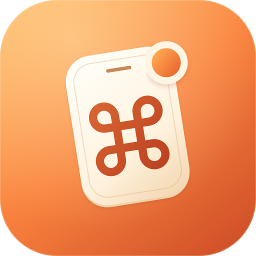
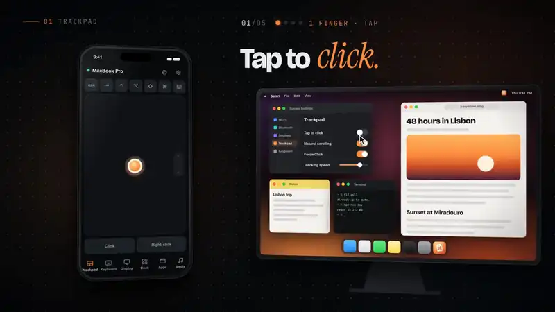
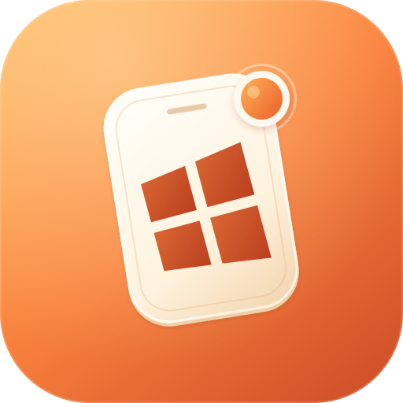
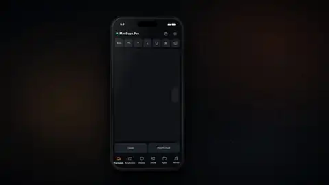
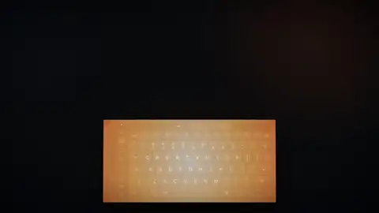
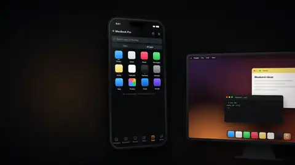
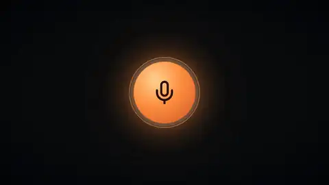
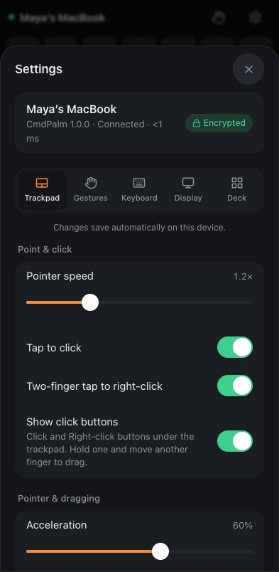
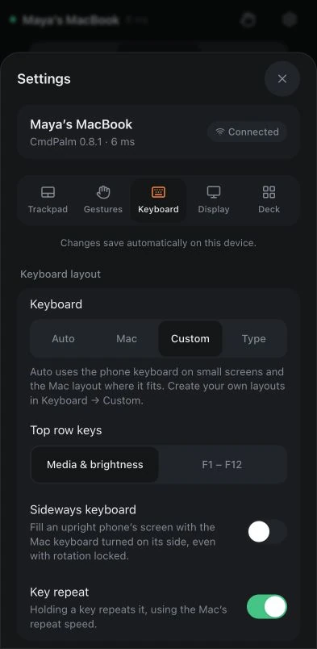
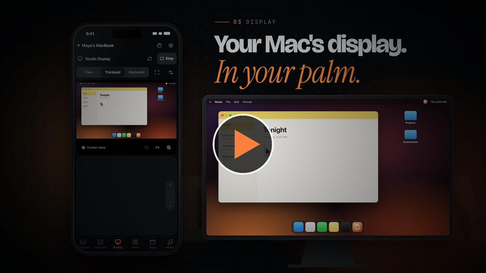

<div align="center">



# CmdPalm

### Your Mac, in your palm.

See and control your Mac from your iPhone, iPad or Android phone.
Screen mirroring, trackpad, keyboard, shortcut deck and voice typing, together in your browser.<br />
**No app to install on the phone. No CmdPalm account. Free and open source.**

<br />

<a href="https://github.com/rahatsagor/CmdPalm/releases/latest/download/CmdPalm.dmg"></a>
&nbsp;
<a href="https://cmdpalm.app"></a>
&nbsp;
<a href="https://cmdpalm.app/docs/"></a>

<br />

[](https://github.com/rahatsagor/CmdPalm/releases/latest)
[](#requirements)
[](#requirements)
[](LICENSE)

[Using Windows? Meet WinPalm](#using-windows-meet-winpalm)

<br />

<a href="https://cmdpalm.app"></a>

</div>

<br />

<table>
<tr>
<td width="33%" align="center" valign="top">

**1. Install on your Mac**<br />
<sub>It lives in the menu bar.</sub>

</td>
<td width="33%" align="center" valign="top">

**2. Scan the QR code**<br />
<sub>Open your phone's camera and scan the QR code.</sub>

</td>
<td width="33%" align="center" valign="top">

**3. You're in control**<br />
<sub>Add it to your home screen and it opens like an app.</sub>

</td>
</tr>
</table>

## Using Windows? Meet WinPalm.

<table>
<tr>
<td width="180" align="center" valign="middle">
<a href="https://github.com/rahatsagor/WinPalm"></a>
</td>
<td valign="middle">

<sub>ALSO FROM RS APPLICATION</sub>

### Your PC, in your palm.

**[WinPalm](https://github.com/rahatsagor/WinPalm)** brings the same phone-to-computer idea to Windows, with native Windows input and integrations. Turn your phone into a Windows trackpad, keyboard and shortcut deck.

**[WinPalm on GitHub →](https://github.com/rahatsagor/WinPalm)** · [Website](https://winpalm.rsapplication.com) · [Windows documentation](https://winpalm.rsapplication.com/docs/)

</td>
</tr>
</table>

## See your Mac. Stay where you are.

<a href="https://cmdpalm.app/guides/mac-screen-on-phone/"></a>

**Screen mirroring** puts a selected Mac display on your phone, with a trackpad
or keyboard beneath the live preview. Choose View or fullscreen for more space,
pinch to zoom, pan, and bring the pointer onto the selected display. Automatic,
Save battery and Sharper text tune the stream; **HD text · lossless** preserves
picture detail up to 4K and updates changed areas up to four times per second.

Screen mirroring requires CmdPalm 1.0.0 or later and is **off by default**.
Enable **Allow screen mirroring** in the Mac’s
General settings, grant macOS **Screen Recording** permission, and allow screen
access for the device under **Devices**. Pairing for control does not grant viewing.
A phone can ask, but you approve on the Mac. One allowed device can view one
selected display at a time. Media is encrypted over WebRTC; HTTPS also protects
the browser page, controls and pairing. Leaving Display or pausing, locking or
sleeping the Mac ends viewing. Audio continues to play on the Mac.

[Screen mirroring setup →](https://cmdpalm.app/docs/screen-mirroring/)

## Everything you need from the couch

<table>
<tr>
<td width="50%" valign="top">



#### Trackpad
Tap to click, drag, two-finger scrolling with real momentum, a one-thumb
scroll strip that keeps going while you hold it, smooth pinch zoom and
two-finger rotation like a Mac trackpad, and three- and four-finger gestures
you can assign. The pointer glides smoothly even on busy Wi-Fi.

</td>
<td width="50%" valign="top">



#### Keyboard
Shows your Mac's own layout, with sticky modifiers, function and media keys,
and follows the Mac when you switch input sources. Shortcuts arrive intact
even on shaky Wi-Fi, and you can hold several keys at once for any
combination. Sideways keyboard fills an upright phone with the full Mac
keyboard.

</td>
</tr>
<tr>
<td valign="top">


#### Custom keyboards
Only the keys you need, laid out how you like: arrows for slides, WASD for
games, or your editing shortcuts. Each key stays pressed for as long as you
touch it.
Tap Edit and drag the keyboard tabs to put your groups in the order you want.

</td>
<td valign="top">


#### Deck
A button grid like a Stream Deck: shortcuts, text snippets, apps, websites,
system actions, Shortcuts automations, mouse clicks and multi-step
sequences that run in order, shared by all your devices. Shell commands work
too, once you allow them.
Tap Edit and drag the page tabs to reorder them across your devices.
Undo and redo in the Edit toolbar recover accepted edits, including deleted
buttons and pages. Changes from another device clear this device’s Undo history.
App buttons offer **Show / hide**, **Open**, **Hide** and **Quit**.
Sequences wait for a Shortcuts automation to finish successfully before
running the next step; a failed Shortcut stops the sequence.

</td>
</tr>
<tr>
<td valign="top">



#### Apps and media
Launch, switch, hide and quit apps with their real icons, including apps on
an external drive. Play, pause and skip, and set the volume, display
brightness and keyboard backlight.

</td>
<td valign="top">



#### Voice
Talk into your phone and your Mac types what you say. Speech is recognised
on the Mac itself and never sent to a server.

</td>
</tr>
</table>

Pair as many phones and tablets as you like. Each one's settings, custom
keyboards and gestures are kept on your Mac too, so they survive a cleared
browser. Use **Copy settings from another device** to choose individual
settings sections and custom keyboards. Only your selection is added or
updated; the rest of your setup stays as it is. Deck pages and buttons are
already shared by all devices paired with the same Mac.

Phone settings use tabs for Trackpad, Gestures, Keyboard, Display and Deck.
Device preferences, backups and connection actions stay below the feature
settings. Changes save automatically, and every section is visible within its
tab. Dictation setup is in Keyboard.

<p align="center">

&nbsp;

</p>

Use **Settings → Back up or restore this device** on the phone to export
your settings and custom keyboards as a file, or review and restore a saved
setup. Device backups leave your name and pairing as they are and never
contain pairing tokens. Export the shared Deck separately from **Settings →
Deck** on the Mac.

<div align="center">

<a href="https://cmdpalm.app/#film"></a>

<sub><a href="https://cmdpalm.app/#film">▶ Watch the 99-second film on cmdpalm.app</a></sub>

</div>

## Made for real life

<table>
<tr>
<td width="33%" valign="top">

**Presenting**<br />
<sub>A custom keyboard with giant ← and → keys, and B for a black screen.
Walk the stage.</sub>

</td>
<td width="33%" valign="top">

**Movie night**<br />
<sub>Play, pause, skip, volume and brightness without leaving the couch.</sub>

</td>
<td width="33%" valign="top">

**Cooking**<br />
<sub>Prop the phone on the counter and scroll the recipe with messy hands.</sub>

</td>
</tr>
<tr>
<td valign="top">

**Gaming**<br />
<sub>A WASD layout where every key stays pressed for as long as you hold it.</sub>

</td>
<td valign="top">

**Streaming**<br />
<sub>Go live, mute the mic and switch scenes from a page on your Deck.</sub>

</td>
<td valign="top">

**See and reply**<br />
<sub>Read a message in Display, then type or dictate a reply without walking back to the Mac.</sub>

</td>
</tr>
</table>

## Away from home, too

CmdPalm works on your local network and can also be reached from another
network through a private VPN such as **Tailscale**. Connect the Mac and phone
to your tailnet, then choose the Mac’s Tailscale address in
**Settings → Phone Setup → Address in the QR code → Custom**. Open that link
and pair your phone. Keep the Mac awake and CmdPalm running.

The screen stream also needs a working direct UDP path. Controls may connect
while Display cannot; video is not guaranteed on every VPN or relayed route.
CmdPalm does not provide a hosted screen relay. Follow the
[remote-access guide](https://cmdpalm.app/docs/remote-access/) for setup and
connection requirements.

## Private by design

<table>
<tr>
<td width="50%" valign="top">

**Your own connection**<br />
Connect over your local network or a private VPN you configure. There is
no CmdPalm account, analytics or hosted control/screen-streaming service.
Optional third-party networking services have their own policies.

</td>
<td width="50%" valign="top">

**Only devices you pair**<br />
Pairing needs the QR code, the PIN shown on your Mac, or your approval on
the Mac. You can remove a device at any time.

</td>
</tr>
<tr>
<td valign="top">

**One switch to stop everything**<br />
Pause in the menu bar stops all input instantly, including text that is
still being typed and shell commands left running in the background.
It also stops screen mirroring.

</td>
<td valign="top">

**Encrypted when you want it**<br />
CmdPalm can create its own certificate for HTTPS, protecting the browser
page, controls and pairing. Screen media is encrypted over WebRTC.
Nothing you type ever appears in its logs.

</td>
</tr>
</table>

Read [SECURITY.md](SECURITY.md) for the full details.

## Requirements

- A Mac with Apple silicon, running macOS 15 Sequoia or later.
- An iPhone or iPad with iOS 17 or later, or an Android phone, on the same
  local network as the Mac, or connected through your private VPN. CmdPalm
  works in Safari, Chrome, Firefox and Samsung
  Internet.

## Install

**With Homebrew**

```sh
brew install --cask rahatsagor/tap/cmdpalm
```

**Or download it**

1. Download [CmdPalm.dmg](https://github.com/rahatsagor/CmdPalm/releases/latest/download/CmdPalm.dmg)
   and drag CmdPalm into Applications.
2. Open CmdPalm from Applications. If macOS blocks it, click **Done** or
   **OK**, then go to **System Settings → Privacy & Security** and click
   **Open Anyway** under Security. Confirm the next prompt and authenticate
   if asked. The button appears only after you try opening the app.
3. Look for CmdPalm in the menu bar and continue with setup.

CmdPalm isn’t notarized by Apple yet. The
[illustrated installation guide](https://cmdpalm.app/download/) walks through
first-launch approval and includes a Terminal alternative. Only approve a
copy you intentionally downloaded from the official releases.


## Get started in a minute

The [CmdPalm docs](https://cmdpalm.app/docs/) explain every screen, setting
and button in detail, from [getting started](https://cmdpalm.app/docs/getting-started/)
to the [encrypted connection](https://cmdpalm.app/docs/encrypted-connection/)
and [troubleshooting](https://cmdpalm.app/docs/troubleshooting/).

1. **Allow Accessibility.** macOS requires it for any app that moves the
   pointer or types. CmdPalm asks on first launch and opens the right page in
   System Settings.
2. **Scan the QR code** in the menu bar with your phone's camera. You can
   also open the address shown under the code and enter the six-digit PIN
   while the CmdPalm menu is open. CmdPalm remembers the phone, so it
   reconnects on its own next time.
3. **Add it to your home screen** for a full-screen app:
   - **iPhone and iPad:** Share → Add to Home Screen.
   - **Android:** Chrome installs web apps only over an encrypted connection.
     Set it up from **Settings → Phone Setup → Encrypted Connection** on the
     Mac, then install CmdPalm from Chrome's menu. Without it, Chrome can add
     a shortcut that opens in a browser tab.

> [!TIP]
> If scanning the QR code on an Android phone doesn't open CmdPalm, set
> **QR link uses** to **IP Address** under the QR code. Some Android phones
> can't open `.local` names.

### Voice typing

Browsers allow the microphone only over an encrypted connection. Open
**Settings → Phone Setup → Encrypted Connection** on the Mac, install the
certificate on your phone as shown, then pair with the **Encrypted link**.
Trackpad, keyboard, Deck and screen mirroring also work over HTTP. You can
dictate with the microphone button on your phone's own keyboard over either
connection.

Your Mac recognises the speech itself, so voice typing needs on-device
recognition for your language. If CmdPalm says it isn't available, turn on
Dictation in **System Settings → Keyboard** so macOS downloads it, or pick
another language.

## Gestures

| On the trackpad | Does |
| --- | --- |
| Tap | Click |
| Two-finger tap | Right-click |
| Touch and hold, then move | Drag |
| Tap, then touch again and move | Drag |
| Two-finger move | Scroll |
| Drag the scroll strip on the edge | Scroll; hold the short strip at the top or bottom to keep going |
| Pinch | Zoom smoothly, as on a Mac trackpad (or ⌘+ and ⌘−) |
| Turn two fingers | Rotate photos, maps and PDFs |
| Two-finger double-tap | Smart zoom (turn it on in settings) |
| Three-finger swipe up / down | Mission Control / App Exposé |
| Three-finger swipe left / right | Switch spaces |
| Three-finger tap | Middle click |
| Three-finger move | Drag (turn it on in settings; three-finger swipes then turn off) |
| Four-finger swipe up / down | Apps (Launchpad on macOS 15) / Show Desktop |
| Thumb and three fingers pinch / spread | Apps / Show Desktop |

The scroll strip can be short, long or hidden under **Settings → Trackpad →
Scrolling** on the phone. Use **Scroll strip options** to change its width
and side, or put it at the screen edge so a finger sliding along the side of
the phone scrolls. Open **Settings → Gestures** to change gesture actions,
with separate tabs for three and four fingers. Pointer acceleration is under
**Trackpad → Pointer & dragging**.

**Modifiers** work three ways: tap for the next key only, double-tap to lock,
or hold while you press another key or click. The hand button in the top bar
lets go of every held key and button at once.

## Troubleshooting

<details>
<summary><strong>The phone can't reach the Mac</strong></summary>
<br />

For ordinary LAN use, both devices need to be on the same network. For VPN connections, check your private network and the [remote-access guide](https://cmdpalm.app/docs/remote-access/). Guest networks and some office or hotel
Wi-Fi block devices from talking to each other. If scanning the QR code
doesn't open CmdPalm, set **QR link uses** to **IP Address** under the QR code.
Check that the macOS firewall allows incoming connections for CmdPalm.

</details>

<details>
<summary><strong>Controls work, but Display won’t connect</strong></summary>
<br />

On the Mac, open **Settings → General** and check **Allow screen mirroring**
and macOS **Screen Recording** permission. Then open **Settings → Devices**
and make sure the phone has screen access. If the view stalls over a VPN,
try connecting both devices to the same Wi-Fi network. Display needs a
direct UDP connection.

[Screen mirroring setup and troubleshooting](https://cmdpalm.app/docs/screen-mirroring/)

</details>

<details>
<summary><strong>The pointer stopped moving after an update</strong></summary>
<br />

macOS ties the Accessibility permission to the app's signature. If CmdPalm is
listed and switched on but nothing happens, select it in **System Settings →
Privacy & Security → Accessibility**, remove it with the – button, then add it
again.

</details>

<details>
<summary><strong>Keys type the wrong characters</strong></summary>
<br />

CmdPalm follows the Mac's current input source. For apps that ignore typed
text, such as games, virtual machines and remote desktops, set **Send text
as** to **Key presses** under **Settings → Keyboard → Text compatibility** and turn **Live**
off in the typing panel. Live typing always sends characters.

</details>

<details>
<summary><strong>Using a VPN, your own DNS name or a reverse proxy</strong></summary>
<br />

Most people never need this. If you connect your devices some other way,
CmdPalm can go along with it:

- **A VPN or mesh network** (WireGuard, Tailscale, ZeroTier and the like):
  in **Settings → Phone Setup**, set **Address in the QR code** to
  **Custom** and pick the Mac's VPN address from the menu next to the field.
- **A name from your own DNS**, such as `studio.home.arpa`: type it in
  **Custom**. CmdPalm accepts connections that use that name.
- **A reverse proxy on the Mac** (Caddy, nginx, or a VPN's HTTPS sharing):
  point the web/control connection at `http://localhost:8790`, type its `https://` address in
  **Custom**, and turn on **Accept connections through a proxy on this Mac**
  under **Settings → Advanced**. The phone then gets an encrypted connection
  from the proxy's certificate.

A web reverse proxy does not carry Display’s separate UDP media stream.
See the [remote-access guide](https://cmdpalm.app/docs/remote-access/) for
screen-stream requirements.

Each address is a separate site to the phone's browser, so pair once for
each address you use.

</details>

<details>
<summary><strong>Something else</strong></summary>
<br />

The [troubleshooting docs](https://cmdpalm.app/docs/troubleshooting/) cover
more problems. Logs are in `~/Library/Logs/CmdPalm`, and they never contain
what you type.
Please include them when you
[open an issue](https://github.com/rahatsagor/CmdPalm/issues/new/choose).

</details>

## Build from source

You need Xcode, Rust, [Bun](https://bun.sh) and
[XcodeGen](https://github.com/yonaskolb/XcodeGen).

```sh
brew install xcodegen
scripts/build-app.sh          # build/Release/CmdPalm.app
```

[CONTRIBUTING.md](CONTRIBUTING.md) covers the project layout and development
workflow. Bug reports and ideas are welcome as
[issues](https://github.com/rahatsagor/CmdPalm/issues); the project does not
accept pull requests.

## License

© 2026 CmdPalm. Free and open source under the
[GNU Affero General Public License v3.0](LICENSE). You may use, study, share
and modify CmdPalm, but anything you distribute or offer to others that is
based on it must be released under the same license, with its full source
code.

<div align="center">
<br />
<a href="https://cmdpalm.app"></a>
<br />
<a href="https://cmdpalm.app"><strong>cmdpalm.app</strong></a>
</div>
