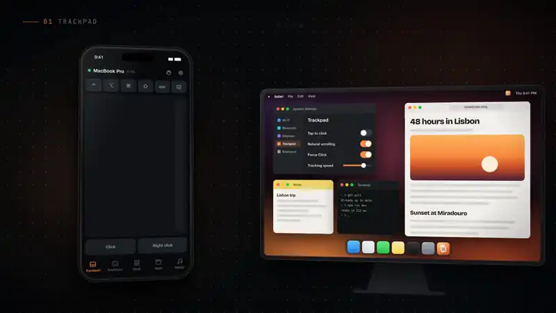
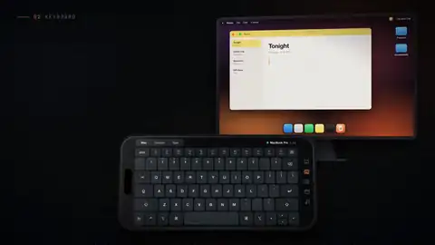
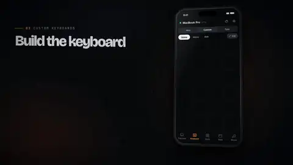
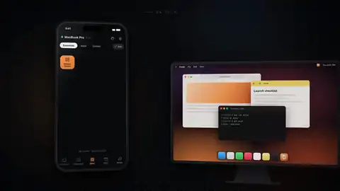
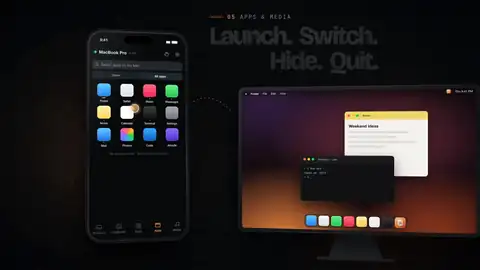
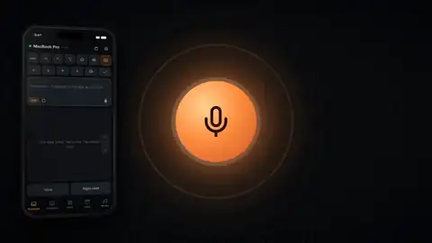
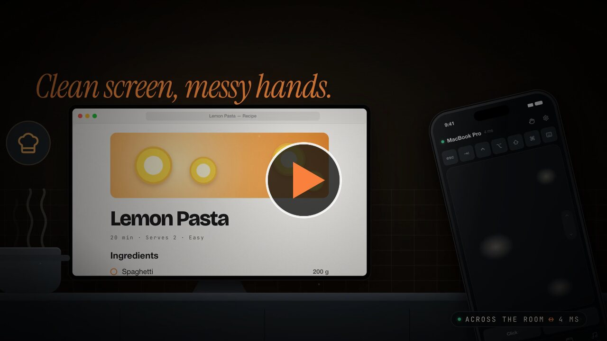

<div align="center">


# CmdPalm

### Your Mac, in your palm.

Turn your iPhone, iPad or Android phone into a trackpad, keyboard and button
deck for your Mac.<br />
**No app to install on the phone. No account. Nothing leaves your network.**

<br />

<a href="https://github.com/rahatsagor/CmdPalm/releases/latest/download/CmdPalm.dmg"></a>
&nbsp;
<a href="https://cmdpalm.app"></a>

<br />

[](https://github.com/rahatsagor/CmdPalm/releases/latest)
[](#requirements)
[](#requirements)
[](LICENSE)

<br />

<a href="https://cmdpalm.app"></a>

</div>

<br />

<table>
<tr>
<td width="33%" align="center" valign="top">

**1. Install on your Mac**<br />
<sub>It lives in the menu bar.</sub>

</td>
<td width="33%" align="center" valign="top">

**2. Scan the QR code**<br />
<sub>With your phone's camera. That's the whole setup.</sub>

</td>
<td width="33%" align="center" valign="top">

**3. You're in control**<br />
<sub>Add it to your home screen and it opens like an app.</sub>

</td>
</tr>
</table>

## Everything you need from the couch

<table>
<tr>
<td width="50%" valign="top">


#### Trackpad
Tap to click, drag, two-finger scrolling with real momentum, a one-thumb
scroll strip that keeps going while you hold it, pinch to zoom, and three-
and four-finger gestures you can assign. The pointer glides smoothly even on
busy Wi-Fi.

</td>
<td width="50%" valign="top">



#### Keyboard
Shows your Mac's own layout, with sticky modifiers, function and media keys.
Shortcuts arrive intact even on shaky Wi-Fi, and you can hold several keys
at once for any combination.

</td>
</tr>
<tr>
<td valign="top">



#### Custom keyboards
Only the keys you need, laid out how you like: arrows for slides, WASD for
games, or your editing shortcuts. Each key stays pressed for as long as you
touch it.

</td>
<td valign="top">



#### Deck
A button grid like a Stream Deck: shortcuts, text snippets, apps, websites,
system actions, Shortcuts automations, mouse clicks and multi-step
sequences, shared by all your devices. Shell commands work too, once you
allow them.

</td>
</tr>
<tr>
<td valign="top">



#### Apps and media
Launch, switch, hide and quit apps with their real icons, including apps on
an external drive. Play, pause and skip, and set the volume, display
brightness and keyboard backlight.

</td>
<td valign="top">



#### Voice
Talk into your phone and your Mac types what you say. Speech is recognised
on the Mac itself and never sent to a server.

</td>
</tr>
</table>

Pair as many phones and tablets as you like. Each one's settings, custom
keyboards and gestures are kept on your Mac too, so they survive a cleared
browser. Set up a new phone in one tap with **Copy settings from another
device**.

<div align="center">

<a href="https://cmdpalm.app/#film"></a>

<sub><a href="https://cmdpalm.app/#film">▶ Watch the 86-second film on cmdpalm.app</a></sub>

</div>

## Made for real life

<table>
<tr>
<td width="33%" valign="top">

**Presenting**<br />
<sub>A custom keyboard with giant ← and → keys, and B for a black screen.
Walk the stage.</sub>

</td>
<td width="33%" valign="top">

**Movie night**<br />
<sub>Play, pause, skip, volume and brightness without leaving the couch.</sub>

</td>
<td width="33%" valign="top">

**Cooking**<br />
<sub>Prop the phone on the counter and scroll the recipe with messy hands.</sub>

</td>
</tr>
<tr>
<td valign="top">

**Gaming**<br />
<sub>A WASD layout where every key stays pressed for as long as you hold it.</sub>

</td>
<td valign="top">

**Streaming**<br />
<sub>Go live, mute the mic and switch scenes from a page on your Deck.</sub>

</td>
<td valign="top">

**Quick replies**<br />
<sub>Tap the mic, say it, and your Mac types every word.</sub>

</td>
</tr>
</table>

## Private by design

<table>
<tr>
<td width="50%" valign="top">

**Local only**<br />
CmdPalm talks to your phone over your own network. There are no accounts,
no analytics and no cloud service. The only outside connection is the
update check.

</td>
<td width="50%" valign="top">

**Only devices you pair**<br />
Pairing needs the QR code, the PIN shown on your Mac, or your approval on
the Mac. You can remove a device at any time.

</td>
</tr>
<tr>
<td valign="top">

**One switch to stop everything**<br />
Pause in the menu bar stops all input instantly, including text that is
still being typed.

</td>
<td valign="top">

**Encrypted when you want it**<br />
CmdPalm creates its own certificate for an encrypted connection, and
nothing you type ever appears in its logs.

</td>
</tr>
</table>

Read [SECURITY.md](SECURITY.md) for the full details.

## Requirements

- A Mac with Apple silicon, running macOS 15 Sequoia or later.
- An iPhone or iPad with iOS 17 or later, or an Android phone, on the same
  network as the Mac. CmdPalm works in Safari, Chrome, Firefox and Samsung
  Internet.

## Install

**With Homebrew**

```sh
brew install --cask rahatsagor/tap/cmdpalm
```

**Or download it**

1. Download [CmdPalm.dmg](https://github.com/rahatsagor/CmdPalm/releases/latest/download/CmdPalm.dmg)
   and drag CmdPalm into Applications.
2. CmdPalm is free and open source, and it isn't notarized by Apple yet, so
   macOS asks you to confirm the first time it opens. Run this once in
   Terminal:

   ```sh
   xattr -dr com.apple.quarantine /Applications/CmdPalm.app
   ```

   Or open CmdPalm, then go to **System Settings → Privacy & Security** and
   click **Open Anyway**.
3. Open CmdPalm from Applications. It appears in the menu bar.

You only do this once. Updates install from inside the app, and Homebrew
skips this step for you.

## Get started in a minute

1. **Allow Accessibility.** macOS requires it for any app that moves the
   pointer or types. CmdPalm asks on first launch and opens the right page in
   System Settings.
2. **Scan the QR code** in the menu bar with your phone's camera. You can
   also open the address shown under the code and enter the six-digit PIN
   while the CmdPalm menu is open. CmdPalm remembers the phone, so it
   reconnects on its own next time.
3. **Add it to your home screen** for a full-screen app:
   - **iPhone and iPad:** Share → Add to Home Screen.
   - **Android:** Chrome installs web apps only over an encrypted connection.
     Set it up from **Settings → Phone Setup → Encrypted Connection** on the
     Mac, then install CmdPalm from Chrome's menu. Without it, Chrome can add
     a shortcut that opens in a browser tab.

> [!TIP]
> If scanning the QR code on an Android phone doesn't open CmdPalm, set
> **QR link uses** to **IP Address** under the QR code. Some Android phones
> can't open `.local` names.

### Voice typing

Browsers allow the microphone only over an encrypted connection. Open
**Settings → Phone Setup → Encrypted Connection** on the Mac, install the
certificate on your phone as shown, then pair with the **Encrypted link**.
Without it, everything else works, and you can still dictate with the
microphone button on your phone's keyboard.

Your Mac recognises the speech itself, so voice typing needs on-device
recognition for your language. If CmdPalm says it isn't available, turn on
Dictation in **System Settings → Keyboard** so macOS downloads it, or pick
another language.

## Gestures

| On the trackpad | Does |
| --- | --- |
| Tap | Click |
| Two-finger tap | Right-click |
| Touch and hold, then move | Drag |
| Tap, then touch again and move | Drag |
| Two-finger move | Scroll |
| Drag the scroll strip on the edge | Scroll; hold the short strip at the top or bottom to keep going |
| Pinch | Zoom (⌘+ and ⌘−) |
| Three-finger swipe up / down | Mission Control / App Exposé |
| Three-finger swipe left / right | Switch spaces |
| Three-finger tap | Middle click |
| Four-finger swipe up / down | Apps (Launchpad on macOS 15) / Show Desktop |

The scroll strip can be short, long or hidden under **Scrolling & zoom** in
the phone's settings. Every gesture can be changed in the phone's settings. Turn on **Show advanced
settings** for pointer acceleration, gesture mapping and text options.

**Modifiers** work three ways: tap for the next key only, double-tap to lock,
or hold while you press another key or click. The hand button in the top bar
lets go of every held key and button at once.

## Troubleshooting

<details>
<summary><strong>The phone can't reach the Mac</strong></summary>
<br />

Both need to be on the same network. Guest networks and some office or hotel
Wi-Fi block devices from talking to each other. If scanning the QR code
doesn't open CmdPalm, set **QR link uses** to **IP Address** under the QR code.
Check that the macOS firewall allows incoming connections for CmdPalm.

</details>

<details>
<summary><strong>The pointer stopped moving after an update</strong></summary>
<br />

macOS ties the Accessibility permission to the app's signature. If CmdPalm is
listed and switched on but nothing happens, select it in **System Settings →
Privacy & Security → Accessibility**, remove it with the – button, then add it
again.

</details>

<details>
<summary><strong>Keys type the wrong characters</strong></summary>
<br />

CmdPalm follows the Mac's current input source. For apps that ignore typed
text, such as games, virtual machines and remote desktops, set **Send text
as** to **Key presses** in the phone's advanced settings.

</details>

<details>
<summary><strong>Using a VPN, your own DNS name or a reverse proxy</strong></summary>
<br />

Most people never need this. If you connect your devices some other way,
CmdPalm can go along with it:

- **A VPN or mesh network** (WireGuard, Tailscale, ZeroTier and the like):
  in **Settings → Phone Setup**, set **Address in the QR code** to
  **Custom** and pick the Mac's VPN address from the menu next to the field.
- **A name from your own DNS**, such as `studio.home.arpa`: type it in
  **Custom**. CmdPalm accepts connections that use that name.
- **A reverse proxy on the Mac** (Caddy, nginx, or a VPN's HTTPS sharing):
  point it at `http://localhost:8790`, type its `https://` address in
  **Custom**, and turn on **Accept connections through a proxy on this Mac**
  under **Settings → Advanced**. The phone then gets an encrypted connection
  from the proxy's certificate.

Each address is a separate site to the phone's browser, so pair once for
each address you use.

</details>

<details>
<summary><strong>Something else</strong></summary>
<br />

Logs are in `~/Library/Logs/CmdPalm`, and they never contain what you type.
Please include them when you
[open an issue](https://github.com/rahatsagor/CmdPalm/issues/new/choose).

</details>

## Build from source

You need Xcode, Rust, [Bun](https://bun.sh) and
[XcodeGen](https://github.com/yonaskolb/XcodeGen).

```sh
brew install xcodegen
scripts/build-app.sh          # build/Release/CmdPalm.app
```

[CONTRIBUTING.md](CONTRIBUTING.md) covers the project layout and development
workflow. Bug reports and ideas are welcome as
[issues](https://github.com/rahatsagor/CmdPalm/issues); the project does not
accept pull requests.

## License

© 2026 CmdPalm. Free and open source under the
[GNU Affero General Public License v3.0](LICENSE). You may use, study, share
and modify CmdPalm, but anything you distribute or offer to others that is
based on it must be released under the same license, with its full source
code.

<div align="center">
<br />
<a href="https://cmdpalm.app"></a>
<br />
<a href="https://cmdpalm.app"><strong>cmdpalm.app</strong></a>
</div>
