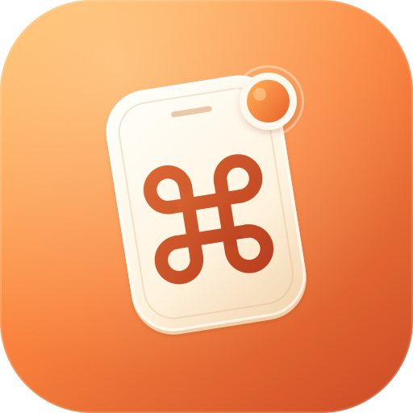

<div align="center">



# CmdPalm

### Your Mac, in your palm.

Turn your iPhone, iPad or Android phone into a trackpad, keyboard and button deck for your Mac.<br />
No app to install on the phone. No account. Nothing leaves your network.

<br />

[**Download for Mac**](https://github.com/rahatsagor/CmdPalm/releases/latest/download/CmdPalm.dmg) &nbsp;·&nbsp;
[Website](https://cmdpalm.app) &nbsp;·&nbsp;
[Release notes](CHANGELOG.md)

<br />

[](https://github.com/rahatsagor/CmdPalm/releases/latest)
[](#requirements)
[](#requirements)
[](LICENSE)

</div>

<br />

CmdPalm lives in your Mac's menu bar and serves a fast web app on your local
network. Scan a QR code with your phone and you are in control. Add it to
your home screen and it opens full screen, just like a native app.

## Everything you need from the couch

<table>
<tr>
<td width="50%" valign="top">

#### Trackpad
Tap to click, drag, two-finger scrolling with real momentum, pinch to zoom,
and three- and four-finger gestures you can assign. The pointer glides
smoothly even on busy Wi-Fi.

</td>
<td width="50%" valign="top">

#### Keyboard
Shows your Mac's own layout, with sticky modifiers, function and media keys.
Shortcuts arrive intact even on shaky Wi-Fi, and you can hold several keys
at once for any combination.

</td>
</tr>
<tr>
<td valign="top">

#### Custom keyboards
Only the keys you need, laid out how you like: arrows for slides, WASD for
games, or your editing shortcuts. Each key stays pressed for as long as you
touch it.

</td>
<td valign="top">

#### Deck
A button grid like a Stream Deck: shortcuts, text snippets, apps, websites,
system actions, Shortcuts automations and multi-step sequences, shared by
all your devices.

</td>
</tr>
<tr>
<td valign="top">

#### Apps and media
Launch, switch, hide and quit apps with their real icons, including apps on
an external drive. Play, pause, skip and set the volume.

</td>
<td valign="top">

#### Voice
Talk into your phone and your Mac types what you say, using on-device speech
recognition where your Mac supports it.

</td>
</tr>
</table>

Your phone settings, custom keyboards and gestures are kept on your Mac too,
so they survive a cleared browser. Set up a new phone in one tap with **Copy
settings from another device**.

## Private by design

- **Local only.** CmdPalm talks to your phone over your own network. There are
  no accounts, no analytics and no cloud service. The only outside connection
  is the update check.
- **Only devices you pair.** Pairing needs the QR code, the PIN shown on your
  Mac, or your approval on the Mac. You can remove a device at any time.
- **One switch to stop everything.** Pause in the menu bar stops all input
  instantly, including text that is still being typed.
- **Encrypted when you want it.** CmdPalm creates its own certificate for an
  encrypted connection, and nothing you type ever appears in its logs.

Read [SECURITY.md](SECURITY.md) for the full details.

## Requirements

- A Mac with Apple silicon, running macOS 15 Sequoia or later.
- An iPhone or iPad with iOS 17 or later, or an Android phone with Chrome, on
  the same network as the Mac.

## Install

**With Homebrew**

```sh
brew install --cask rahatsagor/tap/cmdpalm
```

**Or download it**

1. Download [CmdPalm.dmg](https://github.com/rahatsagor/CmdPalm/releases/latest/download/CmdPalm.dmg)
   and drag CmdPalm into Applications.
2. CmdPalm is free and open source, and it isn't notarized by Apple, so
   macOS asks you to confirm the first time it opens. Run this once in
   Terminal:

   ```sh
   xattr -dr com.apple.quarantine /Applications/CmdPalm.app
   ```

   Or open CmdPalm, then go to **System Settings → Privacy & Security** and
   click **Open Anyway**.
3. Open CmdPalm from Applications. It appears in the menu bar.

You only do this once. Updates install from inside the app, and Homebrew
skips this step for you.

## Get started in a minute

1. **Allow Accessibility.** macOS requires it for any app that moves the
   pointer or types. CmdPalm asks on first launch and opens the right page in
   System Settings.
2. **Scan the QR code** in the menu bar with your phone's camera. You can
   also open the address shown under the code and enter the six-digit PIN.
   CmdPalm remembers the phone, so it reconnects on its own next time.
3. **Add it to your home screen** for a full-screen app:
   - **iPhone and iPad:** Share → Add to Home Screen.
   - **Android:** Chrome installs web apps only over an encrypted connection.
     Set it up from **Settings → Phone Setup → Encrypted Connection** on the
     Mac, then install CmdPalm from Chrome's menu. Without it, Chrome can add
     a shortcut that opens in a browser tab.

> [!TIP]
> If scanning the QR code on an Android phone doesn't open CmdPalm, set
> **QR link uses** to **IP Address** under the QR code. Some Android phones
> can't open `.local` names.

### Voice typing

Browsers allow the microphone only over an encrypted connection. Open
**Settings → Phone Setup → Encrypted Connection** on the Mac, install the
certificate on your phone as shown, then pair with the **Encrypted link**.
Without it, everything else works, and you can still dictate with the
microphone button on your phone's keyboard.

## Gestures

| On the trackpad | Does |
| --- | --- |
| Tap | Click |
| Two-finger tap | Right-click |
| Touch and hold, then move | Drag |
| Tap, then touch again and move | Drag |
| Two-finger move | Scroll |
| Pinch | Zoom (⌘+ and ⌘−) |
| Three-finger swipe up / down | Mission Control / App Exposé |
| Three-finger swipe left / right | Switch spaces |
| Three-finger tap | Middle click |
| Four-finger swipe up / down | Launchpad / Show Desktop |

Every gesture can be changed in the phone's settings. Turn on **Show advanced
settings** for pointer acceleration, gesture mapping and text options.

**Modifiers** work three ways: tap for the next key only, double-tap to lock,
or hold while you press another key or click. The hand button in the top bar
lets go of every held key and button at once.

## Troubleshooting

<details>
<summary><strong>The phone can't reach the Mac</strong></summary>
<br />

Both need to be on the same network. Guest networks and some office or hotel
Wi-Fi block devices from talking to each other. If scanning the QR code
doesn't open CmdPalm, set **QR link uses** to **IP Address** under the QR code.
Check that the macOS firewall allows incoming connections for CmdPalm.

</details>

<details>
<summary><strong>The pointer stopped moving after an update</strong></summary>
<br />

macOS ties the Accessibility permission to the app's signature. If CmdPalm is
listed and switched on but nothing happens, select it in **System Settings →
Privacy & Security → Accessibility**, remove it with the – button, then add it
again.

</details>

<details>
<summary><strong>Keys type the wrong characters</strong></summary>
<br />

CmdPalm follows the Mac's current input source. For apps that ignore typed
text, such as games, virtual machines and remote desktops, set **Send text
as** to **Key presses** in the phone's advanced settings.

</details>

<details>
<summary><strong>Something else</strong></summary>
<br />

Logs are in `~/Library/Logs/CmdPalm`, and they never contain what you type.
Please include them when you
[open an issue](https://github.com/rahatsagor/CmdPalm/issues/new/choose).

</details>

## Build from source

You need Xcode, Rust, [Bun](https://bun.sh) and
[XcodeGen](https://github.com/yonaskolb/XcodeGen).

```sh
brew install xcodegen
scripts/build-app.sh          # build/Release/CmdPalm.app
```

[CONTRIBUTING.md](CONTRIBUTING.md) covers the project layout and development
workflow. Bug reports and ideas are welcome as
[issues](https://github.com/rahatsagor/CmdPalm/issues); the project does not
accept pull requests.

## License

© 2026 CmdPalm. Free and open source under the
[GNU Affero General Public License v3.0](LICENSE). You may use, study, share
and modify CmdPalm, but anything you distribute or offer to others that is
based on it must be released under the same license, with its full source
code.

<div align="center">
<br />
<a href="https://cmdpalm.app"><strong>cmdpalm.app</strong></a>
</div>
